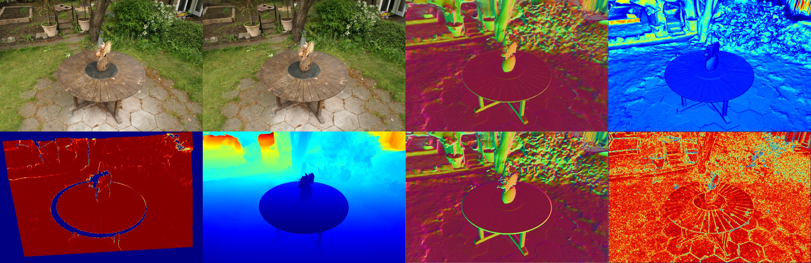

# Minimal 3DGS training demo

This demo primarily shows how to use DSL Splat's rendering interfaces in a
training loop. **The training parameters are examples and are not necessarily
optimal; tune them for your own dataset and task.**

Start with [train_3dgs.py](train_3dgs.py) for rendering calls, optimization,
densification/pruning, and PLY export. Gaussian initialization is in
[model.py](model.py), and COLMAP data loading is in
[colmap_dataset.py](colmap_dataset.py).

## Installation

Use a CUDA-enabled PyTorch environment as described in the
[project installation instructions](../README.md#installation). From the
repository root, install DSL Splat and the demo's additional dependencies:

```bash
python -m pip install -e .
python -m pip install numpy opencv-python scikit-learn tqdm tyro plyfile
```

## Usage

The demo expects a COLMAP scene with `PINHOLE` cameras and the binary
reconstruction in `sparse/0/`. For original images stored in `images/`, run
from the repository root:

```bash
python demo/train_3dgs.py --data-root /path/to/scene --im-stride 1
```

Use `--im-stride 8` if your scene provides downsampled images in `images_8/`.
The default backend is original 3DGS; `--rasterizer-type aaa` selects the AAA
adapter. The trained Gaussians are saved to `splat.ply` by default; change
`--ply-save-path` to choose another output path.

See the script's `Config` dataclass and `--help` for command-line options:

```bash
python demo/train_3dgs.py --help
```

Review the learning rates, densification/pruning thresholds and schedules in
`Config`, as well as the `scene_scale` passed to `strategy.initialize_state()`
in the training script. These settings may need adjustment for your scene.

## PGSR-style training

[train_pgsr.py](train_pgsr.py) adds plane flattening, single-view normal
consistency, and multi-view geometry/NCC supervision. Its training outline
follows PGSR; patch NCC follows RaDe-GS and runs through
[warp_patch_ncc.py](warp_patch_ncc.py). It uses DSL Splat's existing 3DGS or AAA
renderer and DefaultStrategy, rather than reproducing every PGSR training option.

```bash
python -m demo.train_pgsr --data-root /path/to/scene --im-stride 8
```

Images are RGB HWC, and camera poses are ordinary OpenCV world-to-camera
matrices. Rendered plane attributes come from `info["render_extra_signals"]`.
The renderer uses half-integer pixel centers; geometry and NCC use integer
array indices with a matching principal-point adjustment inside this demo.

View supervision starts after step 7000 by default. Neighbor distance limits
use the reconstruction's world units; inspect the `pgsr_*` options and tune
them for your scene. This script also primarily demonstrates usage: its
training parameters are examples, not established optimal settings.

NCC defaults to PGSR's one-pixel patch spacing
(`pgsr_multi_view_half_step=False`). Enable `--pgsr-multi-view-half-step` to
use RaDe-GS's half-pixel spacing instead.

Set `--debug-save-path /path/to/debug` to save a PGSR debug grid every 200
steps, including step 0. The top row contains ground truth, rendered RGB,
rendered normals, and plane distance; the bottom row contains multi-view
geometry weights, plane depth, depth normals, and image-gradient weights.
Before multi-view supervision starts, or when no neighbor is available,
the geometry weights are zero. Filenames include the step and frame name.

Example debug output from the garden scene:


